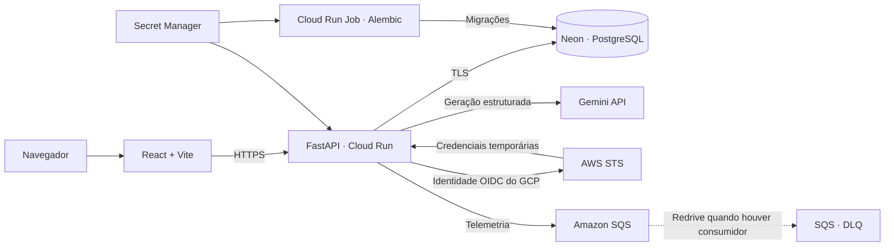

<div align="center">


# Nicolas Hub

**Portfólio interativo · Cloud · DevOps · Backend · Dados**

Um universo em pixel art que conecta projetos reais, arquitetura multicloud, estudos e preparação de carreira.

    

   

[**Explorar funcionalidades**](#-explore-o-hub) · [**Arquitetura**](#-arquitetura-multicloud) · [**Executar localmente**](#-executar-localmente) · [**Documentação**](#-documentação-e-qualidade)

<!-- Coloque a URL pública do Hub aqui quando estiver disponível. -->

</div>

---

## 👾 Bem-vindo ao Nicolas Hub

Sou **Nicolas de Jesus Silva**, estudante de Análise e Desenvolvimento de Sistemas na UniFAAT, com foco em **Cloud, DevOps e Backend**. O Nicolas Hub reúne meus projetos, certificações, notas, experiências de aprendizagem e uma demonstração interativa de arquitetura multicloud.

**A proposta:** transformar um portfólio técnico em uma experiência explorável, com personagens animados, exercícios, documentação e funcionalidades reais.

> [!NOTE]
> Portfólio, conteúdos introdutórios e Coding Gym podem ser explorados sem login. Recursos de geração com Gemini dependem de conta e chave de API configurada. Edições de Notes, vídeos cadastrados e certificados adicionados pela interface ficam no navegador atual.

## 🧭 Explore o Hub

| Seção | O que você encontra | Prévia |
|:--|:--|:--|
| **Portfólio** | Projetos, TCC RECORA, idiomas com dublagem, eventos, certificações e planos para 2027 | [Ver](#-portfólio-e-projetos) |
| **Arquitetura** | Topologia interativa, telemetria GCP → AWS, Gemini e vídeos por projeto | [Ver](#-arquitetura-multicloud) |
| **Academia** | Trilhas, provas com PDFs selecionáveis, simulados e flashcards | [Ver](#-academia-e-coding-gym) |
| **Coding Gym** | Python no navegador, testes e rastreamento por linha | [Ver](#-academia-e-coding-gym) |
| **Notes** | Pastas, folhas Markdown e compartilhamento de leitura | [Ver](#-notes) |
| **Carreira** | Job Fair Google Cloud, comparação de vagas e currículo sob medida | [Ver](#-carreira-e-futuro) |

## 🖼️ Tour visual

<details open><summary><strong>🎮 Portfólio e projetos</strong></summary>

<br />


Projetos com capas e vídeos, certificações, idiomas, eventos e roadmap de 2027.

### RECORA — TCC


Plataforma em desenvolvimento na UniFAAT para organizar o processo comercial de empresas que vendem planos de saúde. Centraliza cadastro de leads, funil, histórico de interações, follow-ups e reativação de oportunidades, com validação de CNPJ via BrasilAPI. A stack inclui **React, TypeScript, Vite, Python, FastAPI, SQLAlchemy, PostgreSQL, Docker, AWS S3, Amazon ECR, Amazon ECS / Fargate, Terraform, Prometheus, Grafana e Ollama**.

</details>

<details><summary><strong>☁️ Arquitetura multicloud</strong></summary>

<br />


Demonstração do fluxo entre GCP e AWS, topologia de serviços e integração com Gemini. O Terraform define **Amazon SQS** para telemetria; **Pub/Sub** aparece como alternativa de referência na interface.

</details>

<details><summary><strong>📚 Academia e Coding Gym</strong></summary>

<br />


Trilhas técnicas, simulados de **15, 25 ou 30 questões**, provas com anotações ou PDFs com texto selecionável e flashcards.


Editor Python com execução no navegador, casos de teste e acompanhamento de valores por linha.

</details>

<details><summary><strong>📝 Notes</strong></summary>

<br />


Organização de pastas e folhas em Markdown, exemplos de leitura pública e links compartilháveis.

</details>

<details><summary><strong>💼 Carreira e futuro</strong></summary>

<br />


Guia de **15 empresas** da Job Fair Google Cloud de **02/12/2026**, análise de vagas e currículo copiável, exportável em HTML ou imprimível em PDF.


Metas de carreira, certificações, idiomas e experiência internacional.

</details>

<details><summary><strong>🏅 Certificações e idiomas</strong></summary>

<br />


</details>

## 🏗️ Arquitetura multicloud



- **Cloud Run:** hospeda a API FastAPI em imagem publicada no Artifact Registry; um Cloud Run Job executa migrações antes da liberação de tráfego.
- **Neon PostgreSQL:** persiste usuários, eventos e cotas compartilhadas; Alembic versiona o esquema.
- **AWS SQS:** recebe telemetria usando federação OIDC GCP → AWS STS e credenciais temporárias. A DLQ está disponível para redrive quando houver consumidor conectado.
- **Gemini:** gera material de estudo e análises de vagas via backend; FastAPI valida respostas estruturadas e seleções para o currículo.
- **Terraform:** define serviço e job no GCP, filas SQS e DLQ, e federação de identidade. O frontend pode ser publicado na Vercel.

**Importante:** o Pub/Sub exibido na topologia interativa é uma alternativa de referência; o Terraform define SQS como caminho de telemetria. Veja o [guia completo de arquitetura](docs/arquitetura-multicloud.md).

> [!NOTE]
> A arquitetura e os arquivos Terraform podem ser revisados e validados localmente sem uma conta de nuvem. Isso confirma a consistência estática da configuração, mas não comprova que IAM, federação OIDC, segredos, rede, migrações e serviços funcionarão na conta real. Essa confirmação exige provisionar o ambiente e executar o fluxo de ponta a ponta após o deploy.

## 🐳 Executar localmente

### Docker Compose (recomendado)

**Requisito:** Docker com Compose v2. Na raiz do repositório, em PowerShell:

```powershell
Copy-Item .env.example .env
```

Defina valores locais fortes para `POSTGRES_PASSWORD` e `JWT_SECRET_KEY`. Para gerar uma chave JWT:

```powershell
python -c "import secrets; print(secrets.token_urlsafe(48))"
```

Depois:

```powershell
docker compose up --build
```

| Serviço | Endereço local |
|---|---|
| Hub | http://localhost:3000 |
| Swagger | http://localhost:8000/docs |
| Saúde da API | http://localhost:8000/health |

O Compose inicia PostgreSQL, aplica as migrações Alembic e sobe API e frontend. Para parar: `docker compose down`. O volume nomeado preserva os dados.

<details><summary><strong>⚙️ Variáveis de ambiente</strong></summary>

| Configuração | Uso |
|---|---|
| `GEMINI_API_KEY` ou `AI_API_KEY` | Geração de material, assistência e análise de vagas |
| `AI_MODEL`, `AI_TIMEOUT_SECONDS` | Modelo Gemini e timeout |
| `AWS_REGION`, `SQS_QUEUE_URL` | Publicação de telemetria |
| `FRONTEND_ORIGINS` | CORS com API em domínio separado |
| `DATABASE_URL` | Conexão da API fora do Compose |

O `.env.example` usa valores de demonstração. **Nunca publique `.env` ou credenciais.** Em produção, use Secret Manager e identidade federada.

</details>

<details><summary><strong>💻 Desenvolvimento sem Docker</strong></summary>

Requisitos: **Python 3.12+**, **Node.js 22** e PostgreSQL acessível. Configure `DATABASE_URL` com `postgresql+psycopg://` e `JWT_SECRET_KEY`.

**Terminal 1 — API:**

```powershell
python -m venv .venv
.\.venv\Scripts\Activate.ps1
pip install -r requirements.txt
alembic -c backend/alembic.ini upgrade head
uvicorn app.main:app --app-dir backend --reload
```

**Terminal 2 — frontend:**

```powershell
cd frontend
npm ci
npm run dev
```

Vite usa a porta **3000** e encaminha `/api` e `/health` para a API na porta **8000**. `npm run build` gera `frontend/dist`.

</details>

<details><summary><strong>🚀 Publicação (GCP + AWS + Vercel)</strong></summary>

1. Configure Neon com TLS e cadastre `DATABASE_URL`, `JWT_SECRET_KEY` e `GEMINI_API_KEY` no Secret Manager.
2. Siga o [guia Terraform AWS e GCP](docs/arquitetura-multicloud.md) e revise os planos em `terraform/` e `terraform/gcp/` antes de aplicar.
3. Publique a imagem de `backend/Dockerfile` no Artifact Registry, execute o job de migração e configure as origens HTTPS.
4. Na Vercel, configure `frontend` como raiz, `npm run build` como build e `dist` como saída; defina `VITE_API_BASE_URL` com a URL do Cloud Run.
5. Verifique `/health`, publique um evento autenticado e confirme a mensagem no SQS. Cadastros públicos ficam fechados por padrão em produção.

</details>

## 📁 Estrutura do repositório

```text
backend/app/        API, perfil mestre, rotas e integrações
backend/migrations/ Migrações PostgreSQL com Alembic
frontend/src/       React, estilos, páginas e console interativo
frontend/public/    GIFs, imagens e áudio
src/                Motor Python e CLI de exercícios
terraform/          AWS SQS, DLQ e federação de identidade
terraform/gcp/      Cloud Run, Artifact Registry e Secret Manager
docs/               Arquitetura, mídia e guias de estudo
tests/              Testes de contrato da API e motor Python
```

## 📖 Documentação e qualidade

**Guias:** [Arquitetura multicloud](docs/arquitetura-multicloud.md) · [Estudos](docs/STUDY_GUIDE.md) · [SQL e NoSQL](docs/databases_guide.md) · [Cloud e Terraform](docs/cloud_and_terraform.md) · [Python](docs/python_mastery.md)

**Configuração:** [Links profissionais](frontend/src/config/profileLinks.ts) · [Perfil mestre](backend/app/data/profile.json) · [Empresas da Job Fair](backend/app/data/job_fair.json)

**Mídia:** capas em `frontend/public/assets/projetos/`, animações em `frontend/public/assets/Animacoes/` e quatro gravações autorais em `frontend/public/assets/audios/`. Cada idioma tem um controle para ouvir ou pausar a gravação com legendas. Os vídeos publicados pela administração ficam no PostgreSQL.

### Demonstração pública em planos gratuitos

O Blueprint [render.yaml](render.yaml) seleciona uma instância **Free** para
FastAPI em container. Use um projeto **Neon Free**, com `DATABASE_URL` no formato
`postgresql+psycopg://…?sslmode=require`. O container usa `PORT` (padrão 8080) e
aplica as migrações quando `RUN_MIGRATIONS=true`. Na Vercel Hobby, aponte o
diretório raiz para `frontend` e defina somente `VITE_API_BASE_URL` com a URL
HTTPS do backend. Configure `FRONTEND_ORIGINS` com a origem HTTPS exata do
frontend. Koyeb Free pode executar a mesma imagem e configuração.

Deixe `SQS_QUEUE_URL`, `AWS_SQS_ROLE_ARN` e `AWS_WEB_IDENTITY_AUDIENCE` vazias
para a demonstração. A telemetria autorizada é gravada no PostgreSQL e
responde `200 OK` com `status: SIMULATED_CLOUD_EVENT` e os campos do evento.
O mesmo retorno preserva o evento quando a publicação na fila configurada
falha. O Terraform serve como referência implantável e pode ser validado
sem criar recursos.

Para manter a demonstração dentro das franquias gratuitas, monitore o consumo
e confira o comportamento da conta ao atingir os limites. Render Free pode
suspender serviços e, conforme a configuração da conta, cobrar consumo
excedente. Os planos de demonstração também podem ter suspensão por inatividade.
[Render Free](https://render.com/docs/free) · [Vercel Hobby](https://vercel.com/docs/plans/hobby) · [Neon Free](https://neon.com/pricing)

### Administração e modo leitura

Visitantes podem ler o conteúdo público e usar atividades executadas no
navegador. Todas as rotas de escrita da API exigem a chave administrativa ou
uma sessão administrativa assinada. Com `ADMIN_SECRET_KEY` ausente, as
operações de escrita ficam desabilitadas. Insira o segredo aleatório de pelo
menos 32 caracteres no `.env` local ou no painel de segredos do host. A chave
só é enviada ao FastAPI como `X-Admin-Key` durante a autenticação pela interface.

Para criar a primeira conta administrativa, habilite temporariamente
`PUBLIC_REGISTRATION=true` no backend e envie `POST /api/v1/auth/register`
com o cabeçalho `X-Admin-Key` e o JSON de e-mail e senha. Depois restaure
`PUBLIC_REGISTRATION=false`. Use **Admin** no cabeçalho para entrar com a
conta e a chave. A sessão expira e a troca da chave invalida tokens
administrativos anteriores. Habilite Gemini à parte, com a credencial
restrita ao servidor e dentro da franquia da conta.

Para criar a conta no Neon ou redefinir a senha de uma conta existente sem
abrir o cadastro, rode na raiz do repositório:

```sh
docker compose build api
docker compose run --rm --no-deps --entrypoint python api -m app.admin_account
```

Informe a URL do Neon usada no Render, o e-mail e a nova senha nos prompts.
A URL e a senha são digitadas em modo oculto. Para entrar no site use a
`ADMIN_SECRET_KEY` configurada no Render junto com o e-mail e a nova senha.

Em **Arquitetura → Vídeos**, uma sessão administrativa permite publicar links
de vídeos do YouTube. O banco armazena o identificador do vídeo, que aparece
para visitantes na aba Arquitetura. Vídeos cadastrados na
versão anterior podem ser publicados pelo botão **Publicar vídeos salvos neste
navegador**. Use o mesmo navegador e endereço em que foram cadastrados ou cole
os links no endereço do deploy para publicá-los no banco de produção.
No mesmo painel, **Adicionar ou trocar a capa** publica uma imagem PNG, JPEG ou
WebP de até 4 MB. O backend redimensiona e grava a imagem no PostgreSQL.
Em **Portfólio → Projetos**, o vídeo mais recente publicado para o Nicolas Hub
aparece acima da grade de projetos com capas.

Em **Notes**, o admin pode salvar rascunhos locais e usar **Publicar para
visitantes** nas folhas escolhidas. As folhas publicadas ficam no PostgreSQL
e podem ser lidas sem login. O admin pode atualizar ou retirar a publicação.

**Testes e lint:**

```powershell
pytest -q
python -m black --check backend/app src tests
python -m flake8 backend/app src tests
```

A suíte usa SQLite temporário e substitui o provedor Gemini nos testes de contrato. O GitHub Actions também valida infraestrutura e títulos de commits em PRs. Padrão: **Conventional Commits**, como `feat(academy): add PDF study notes` e `docs: update deployment guide`.

## 🎬 Demonstração

> O vídeo de demonstração será adicionado aqui quando estiver disponível.

---

<div align="center">

**Construído com código, nuvem e um pouco de pixel art.** 👾

*Nicolas de Jesus Silva · Nicolas Hub*

</div>
