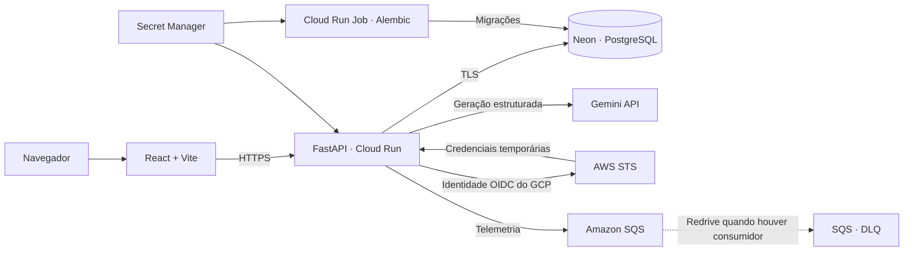

# Nicolas Hub

Portfólio técnico, academia de Cloud e Dados e preparação de carreira de Nicolas de Jesus Silva. A interface reúne projetos, certificações, notas de estudo e uma demonstração de arquitetura multicloud.

## O que o Hub oferece

| Área | Recursos |
| --- | --- |
| Portfólio | Projetos com capas e vídeos, TCC RECORA em desenvolvimento, idiomas com dublagem, eventos, certificações e roadmap de 2027 |
| Arquitetura | Topologia interativa, fluxo de telemetria entre GCP e AWS, integração com Gemini e vídeos por projeto |
| Academia | Trilhas técnicas, provas com anotações ou PDFs com texto selecionável, simulados de 15, 25 ou 30 questões e flashcards |
| Coding Gym | Editor Python com execução no navegador, casos de teste e rastreamento de valores por linha |
| Notes | Pastas e folhas em Markdown, exemplos de leitura pública e links compartilháveis |
| Carreira | Guia das 15 empresas da Job Fair Google Cloud de 02/12/2026, análise de vagas e currículo copiável, exportável em HTML ou imprimível em PDF |

O material introdutório, o Coding Gym e o portfólio podem ser explorados sem
login. A geração de conteúdo com Gemini exige uma conta e a chave configurada
na API. Edições do Notes, vídeos cadastrados e certificados adicionados pela
interface ficam no navegador.

## Arquitetura multicloud



- **Cloud Run** executa a API FastAPI a partir de uma imagem no Artifact
  Registry. Um Cloud Run Job aplica migrações antes de liberar tráfego.
- **Neon PostgreSQL** armazena usuários, eventos e cotas compartilhadas. A API
  usa alembic para versionar o esquema.
- **AWS SQS** recebe telemetria. A conta de serviço do Cloud Run usa um token
  OIDC e a role AWS fornece credenciais temporárias por STS. A DLQ fica
  disponível para redrive quando houver um consumidor conectado.
- **Gemini** gera material de estudo e análises de vagas no backend. O FastAPI
  valida as respostas estruturadas e as seleções usadas no currículo.
- **Terraform** define o serviço e o job no GCP, a fila SQS, a DLQ e a federação
  de identidade. A interface pode ser publicada separadamente na Vercel.

O Pub/Sub exibido no diagrama interativo é uma alternativa de referência para
mensageria. O caminho de telemetria provisionado usa SQS. O provisionamento
completo, as permissões e a sequência de migração estão no
[guia de arquitetura multicloud](docs/arquitetura-multicloud.md).

## Executar localmente com Docker

Requisitos: Docker com Compose v2. Execute os comandos na raiz do checkout.

```powershell
Copy-Item .env.example .env
```

Substitua `POSTGRES_PASSWORD` e `JWT_SECRET_KEY` no `.env` por valores locais
fortes. Para gerar uma chave JWT aleatória com Python:

```powershell
python -c "import secrets; print(secrets.token_urlsafe(48))"
docker compose up --build
```

O Compose inicia PostgreSQL, aplica as migrações com Alembic e sobe a API e o
frontend. Acesse o [Hub](http://localhost:3000), o
[Swagger](http://localhost:8000/docs) e a [saúde da API](http://localhost:8000/health).
Para parar os serviços, use `docker compose down`. Os dados permanecem no
volume nomeado.

| Configuração | Uso |
| --- | --- |
| `GEMINI_API_KEY` ou `AI_API_KEY` | Habilita geração de material, assistência e análise de vagas |
| `AI_MODEL`, `AI_TIMEOUT_SECONDS` | Ajustam o modelo Gemini e o tempo limite da chamada |
| `AWS_REGION`, `SQS_QUEUE_URL` | Habilitam a publicação de telemetria na fila |
| `FRONTEND_ORIGINS` | Define origens permitidas no CORS quando a API tem domínio separado |
| `DATABASE_URL` | Define a conexão da API em execução fora do Compose |

O `.env.example` contém valores de demonstração. Mantenha o `.env` e as
credenciais fora do Git. Em produção, configure os segredos no Secret Manager
e use identidade federada para publicar na AWS.

### Desenvolvimento sem Docker

Use Python 3.12+, Node.js 22 e uma instância PostgreSQL acessível. Configure
`DATABASE_URL` com o esquema `postgresql+psycopg://` e `JWT_SECRET_KEY`, por
exemplo no `.env`. Em um terminal na raiz:

```powershell
python -m venv .venv
.\.venv\Scripts\Activate.ps1
pip install -r requirements.txt
alembic -c backend/alembic.ini upgrade head
uvicorn app.main:app --app-dir backend --reload
```

Em outro terminal, configure o frontend:

```powershell
cd frontend
npm ci
npm run dev
```

O servidor Vite usa a porta 3000 e encaminha `/api` e `/health` para a API na
porta 8000. `npm run build` gera o artefato em `frontend/dist`.

## Publicação

1. Configure o banco Neon com TLS e cadastre `DATABASE_URL`,
   `JWT_SECRET_KEY` e `GEMINI_API_KEY` no Secret Manager.
2. Siga o [guia Terraform AWS e GCP](docs/arquitetura-multicloud.md) e revise
   os planos de `terraform/` e `terraform/gcp/` antes de aplicar mudanças.
3. Publique a imagem do `backend/Dockerfile` no Artifact Registry, execute
   o job de migração e configure as origens HTTPS autorizadas.
4. Na Vercel, use `frontend` como diretório raiz, `npm run build` como comando e
   `dist` como saída. Aponte `VITE_API_BASE_URL` para a URL da API Cloud Run.
5. Verifique `/health`, publique um evento autenticado e confira a mensagem na
   fila. Cadastros públicos ficam fechados por padrão em produção.

## Personalização e mídia

- [Links profissionais e repositórios](frontend/src/config/profileLinks.ts)
- [Perfil mestre](backend/app/data/profile.json) e
  [empresas da feira](backend/app/data/job_fair.json)
- Capas de projetos em `frontend/public/assets/projetos/` e GIFs em
  `frontend/public/assets/Animacoes/`.
- Trilhas e dublagens em `frontend/public/assets/audios/`. **Música / Áudio**
  começa desligado e acompanha a navegação interna após a ativação. A trilha
  global pausa durante Idiomas, e as falas acompanham as legendas do cartão.
- O painel de vídeos em `/arquitetura#videos` aceita links do YouTube por
  projeto. Os vídeos cadastrados na interface ficam no navegador atual.

### Capturas e vídeo de demonstração

| Material | Local previsto | Conteúdo |
| --- | --- | --- |
| Captura do Portfólio | `docs/media/portfolio.png` | Hero, projetos e idiomas |
| Captura de Arquitetura | `docs/media/arquitetura.png` | Topologia multicloud e fluxo de eventos |
| Captura da Academia | `docs/media/academia.png` | Simulado e Coding Gym |
| Vídeo de demonstração | Link não listado do YouTube a adicionar | Navegação guiada, arquitetura e exemplos de estudo |

## Qualidade e manutenção

```powershell
pytest -q
python -m black --check backend/app src tests
python -m flake8 backend/app src tests
```

A suíte usa SQLite temporário, com substituição do provedor Gemini em testes
de contrato. Os fluxos do GitHub Actions também validam a infraestrutura e os
títulos dos commits em pull requests. Use Conventional Commits, como
`feat(academy): add PDF study notes` ou `docs: update deployment guide`.

Consulte o [guia mestre de estudos](docs/STUDY_GUIDE.md), o
[guia de SQL e NoSQL](docs/databases_guide.md), o
[guia de Cloud e Terraform](docs/cloud_and_terraform.md) e o
[guia de Python](docs/python_mastery.md).

## Estrutura do repositório

```text
backend/app/        API, perfil mestre, rotas e integrações
backend/migrations/ Migrações do PostgreSQL com Alembic
frontend/src/       React, estilos, páginas e console interativo
frontend/public/    GIFs, imagens e áudio servido no navegador
src/                Motor Python e CLI de exercícios
terraform/          AWS SQS, DLQ e federação de identidade
terraform/gcp/      Cloud Run, Artifact Registry e Secret Manager
docs/               Arquitetura e guias de estudo
tests/              Testes de contratos da API e do motor Python
```
