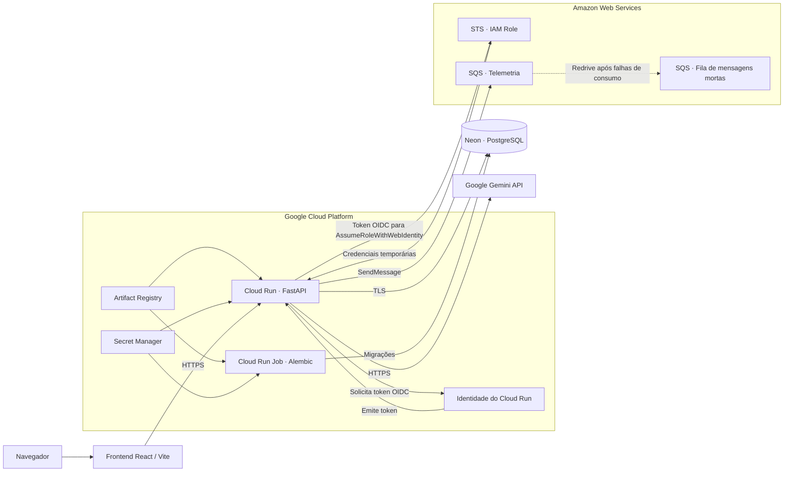

# Arquitetura multicloud do Nicolas Hub

O GCP executa a API FastAPI. A AWS recebe a telemetria em uma fila SQS. O
PostgreSQL fica no Neon e guarda usuários, eventos e cotas da API. O frontend
React/Vite usa a URL HTTPS da API e pode ser publicado na Vercel.

## Componentes e identidade

O Terraform da [AWS](../terraform/) cria a fila, a DLQ e, quando informado o
ID numérico da conta de serviço do Cloud Run, uma role para publicar e ler
atributos da fila. O Terraform [GCP](../terraform/gcp/) cria o Artifact
Registry, a identidade de serviço, referências ao Secret Manager, a API e o
job Alembic. Os valores dos segredos são adicionados diretamente ao Secret
Manager.

A conta de serviço do Cloud Run solicita um token OIDC com a audiência
esperada pela role AWS. O AWS STS valida a audiência e a identidade da conta
de serviço e retorna credenciais temporárias. A DLQ cobre erros de consumo
quando um consumidor é conectado. A demonstração inicial cobre publicação
e inspeção da mensagem na AWS. [Federação AWS com identidade GCP](https://aws.amazon.com/blogs/security/access-aws-using-a-google-cloud-platform-native-workload-identity/)

## Ordem para provisionar

1. Autentique as duas CLIs localmente. Para GCP, use
   `gcloud auth application-default login` com um projeto e faturamento
   configurados. Para AWS, use o perfil do IAM Identity Center ou a sessão
   temporária da sua conta e confira a identidade com `aws sts get-caller-identity`.
2. Rode `terraform -chdir=terraform/gcp init` e `terraform -chdir=terraform/gcp plan`
   com `project_id` e `api_image` vazio (`null`). Revise os recursos antes
   do primeiro `apply`. Essa fase cria o repositório de imagens, a conta de
   serviço e os identificadores de segredos.
3. Use a saída `google_service_account_subject` como variável no Terraform AWS
   em `terraform/`. Revise o plano da fila, DLQ e role. A saída
   `cloud_run_telemetry` fornece `region`, `queue_url`, `role_arn` e
   `audience` para `aws_telemetry` no GCP.
4. Cadastre as versões de `DATABASE_URL`, `JWT_SECRET_KEY` e `GEMINI_API_KEY`
   no Secret Manager. Use a conexão Neon com TLS e o driver `postgresql+psycopg`.
   Configure `secret_versions` conforme as versões cadastradas.
5. Publique a imagem `linux/amd64` usando `backend/Dockerfile` e a raiz do
   checkout como contexto. Configure `api_image` com o URI do Artifact Registry
   fixado por digest e mantenha `public_api=false` durante a migração. Execute
   o job retornado em `migration_job` com `gcloud run jobs execute NOME --wait`.
6. Defina `frontend_origins` com a origem HTTPS do frontend e habilite
   `public_api`. Configure `VITE_API_BASE_URL` na publicação React/Vite.
   Verifique `/health`, publique um evento de analytics autenticado e confira
   a mensagem na fila pelo console AWS.

Os dois diretórios Terraform têm estados independentes. Use um backend remoto
com acesso restrito antes de compartilhar o ambiente. Os projetos e os estados
reais ficam disponíveis na conta que fizer o provisionamento.
